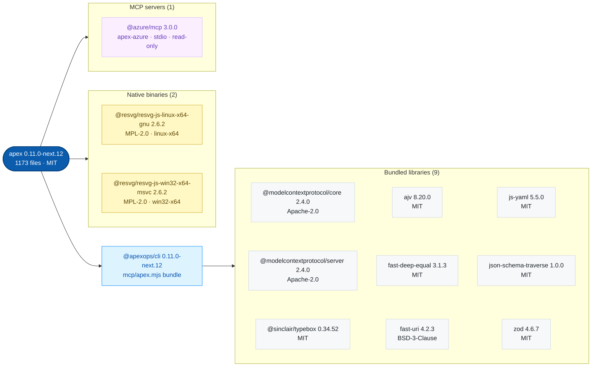

# APEX Plugins

[](https://github.com/jonathan-vella/apex-plugins/actions/workflows/validate.yml)
[](https://github.com/jonathan-vella/apex-plugins/actions/workflows/attest.yml)

GitHub Copilot Agent Plugin marketplace for **[APEX vNext](https://github.com/jonathan-vella/apex-vnext)** — governed Azure infrastructure-as-code workflows for the Copilot CLI, VS Code, and the GitHub Copilot app.


## Quick Start

Install through the Copilot CLI marketplace (shared across Copilot CLI, VS Code, and the GitHub Copilot app):

```bash
copilot plugin marketplace add jonathan-vella/apex-plugins
copilot plugin install apex@apex-plugins
```

## Verify Integrity

Compare your installed plugin directory against [`.github/plugin/provenance.json`](.github/plugin/provenance.json) and verify the signed GitHub SBOM attestation:

```bash
node tools/validate-marketplace.mjs --tree ~/.copilot/installed-plugins/apex-plugins/apex
gh attestation verify .github/plugin/sbom.cdx.json --repo jonathan-vella/apex-plugins
```

## Software Bill of Materials

CI checks [`.github/plugin/sbom.cdx.json`](.github/plugin/sbom.cdx.json) on every PR and signs a GitHub attestation on every merge to `main`.

<!-- sbom:start -->


| Plugin | Version | Source Commit | Tree SHA-256 | CycloneDX 1.6 Inventory |
| :--- | :--- | :--- | :--- | :--- |
| **`apex`** (`MIT`) | `0.11.0-next.12` | [`d6e97a594eae`](https://github.com/jonathan-vella/apex-vnext/commit/d6e97a594eaebe93c159be9ee55c11358276dd40) | `3cb1644c85cd2a4d…` | [`.github/plugin/sbom.cdx.json`](.github/plugin/sbom.cdx.json) (1173 files) |

| Component | Version | Kind | Licence | Digest |
| :--- | :--- | :--- | :--- | :--- |
| `@apexops/cli` | `0.11.0-next.12` | CLI & MCP bundle source | `MIT` | — |
| `@azure/mcp` | `3.0.0` | External MCP server (`apex-azure`, read-only) | — | — |
| `@modelcontextprotocol/core` | `2.4.0` | Bundled library | `Apache-2.0` | `sha-512:cfc4012aa75f…` |
| `@modelcontextprotocol/server` | `2.4.0` | Bundled library | `Apache-2.0` | `sha-512:ae047dcb149a…` |
| `@sinclair/typebox` | `0.34.52` | Bundled library | `MIT` | `sha-512:5e231087baaa…` |
| `ajv` | `8.20.0` | Bundled library | `MIT` | `sha-512:4e16e58be3a5…` |
| `fast-deep-equal` | `3.1.3` | Bundled library | `MIT` | `sha-512:7f7a90f68432…` |
| `fast-uri` | `4.2.3` | Bundled library | `BSD-3-Clause` | `sha-512:2353d7c0fe5e…` |
| `js-yaml` | `5.5.0` | Bundled library | `MIT` | `sha-512:a5a36be0b148…` |
| `json-schema-traverse` | `1.0.0` | Bundled library | `MIT` | `sha-512:34cf3f3fd9f7…` |
| `zod` | `4.6.7` | Bundled library | `MIT` | `sha-512:83c5b60f6914…` |
| `@resvg/resvg-js-linux-x64-gnu` | `2.6.2` | Native binary (`linux-x64`) | `MPL-2.0` | `sha-256:56c967fa1e26…` |
| `@resvg/resvg-js-win32-x64-msvc` | `2.6.2` | Native binary (`win32-x64`) | `MPL-2.0` | `sha-256:a762c7c3d34a…` |
<!-- sbom:end -->

## Repository Map

| Path | Purpose |
| :--- | :--- |
| [`.github/plugin/marketplace.json`](.github/plugin/marketplace.json) | Copilot CLI plugin marketplace manifest |
| [`.github/plugin/provenance.json`](.github/plugin/provenance.json) | Pinned `apex-vnext` commit SHA, CLI version, and SHA-256 tree hash |
| [`.github/plugin/sbom.cdx.json`](.github/plugin/sbom.cdx.json) | Deterministic CycloneDX 1.6 SBOM covering every component and file |
| [`plugins/apex/`](plugins/apex) | Built plugin tree (agents, skills, hooks, bundled MCP server, native binaries) |
| [`tools/validate-marketplace.mjs`](tools/validate-marketplace.mjs) | Zero-dependency marketplace and tree-hash validator |
| [`tools/generate-sbom.mjs`](tools/generate-sbom.mjs) | Zero-dependency CycloneDX SBOM and README diagram generator |

> [!NOTE]
> `plugins/apex/` holds built artifacts from [`apex-vnext`](https://github.com/jonathan-vella/apex-vnext) with end-of-line conversion disabled in [`.gitattributes`](.gitattributes) so every checkout keeps the exact bytes hashed at build time.

---

[Contributing](CONTRIBUTING.md) · [MIT Licence](LICENSE)
