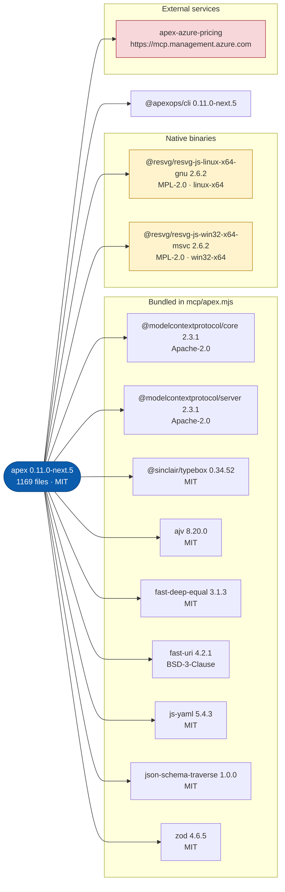

# APEX plugins

Agent Plugins marketplace for [APEX vNext](https://github.com/jonathan-vella/apex-vnext), an Azure infrastructure-as-code
agent workflow for GitHub Copilot.

Releases are published from apex-vnext through reviewed pull requests in this repository. Each release pins the APEX
source commit SHA and records the plugin's tree hash as provenance. Tags are release labels only.

## Install

The repository is a Copilot CLI plugin marketplace (`.github/plugin/marketplace.json`). Install through the Copilot CLI
store, which VS Code and the GitHub Copilot app read. Install through one channel only.

```bash
copilot plugin marketplace add jonathan-vella/apex-plugins
copilot plugin install apex@apex-plugins
```

## Layout

```text
.github/plugin/marketplace.json   marketplace listing (Copilot CLI marketplace format)
.github/plugin/provenance.json    per plugin: source commit SHA, bundled CLI version and tree hash
.github/plugin/sbom.cdx.json      CycloneDX SBOM of the plugin tree
.github/workflows/validate.yml    the validate check
.github/workflows/attest.yml      signs an SBOM attestation on every merge to main
plugins/<name>/                   the exact plugin tree built by apex-vnext (added by the first release)
tools/validate-marketplace.mjs    validator and tree-hash tool (no dependencies)
tools/generate-sbom.mjs           SBOM and README diagram generator (no dependencies)
tools/sbom-bundled-deps.json      versions of the libraries bundled into mcp/apex.mjs
```

`plugins/<name>/` holds built files, not sources: the APEX build bundles the MCP server and copies agents, skills, hooks
and assets. `.gitattributes` disables end-of-line conversion so every checkout keeps the bytes the build hashed.

## Verify what you install

Compare the installed folder with the tree hash in `.github/plugin/provenance.json`:

```bash
node tools/validate-marketplace.mjs --tree ~/.copilot/installed-plugins/apex-plugins/apex
```

## Software bill of materials

`.github/plugin/sbom.cdx.json` is a CycloneDX 1.6 SBOM of the hosted plugin. CI regenerates it and fails if it or the
section below is stale. Every merge to `main` also signs a GitHub attestation for the SBOM file.

<!-- sbom:start -->


Version `0.11.0-next.5` · source commit [`bc781afc03a1`](https://github.com/jonathan-vella/apex-vnext/commit/bc781afc03a18a9b5c3007813dfa8756bcf62af9) · tree hash `e1a1794d7c9a189e…` · 1169 files. The full inventory with a SHA-256 for every file is [`.github/plugin/sbom.cdx.json`](.github/plugin/sbom.cdx.json) (CycloneDX 1.6).

| Component | Version | Kind | Licence | Digest |
| --- | --- | --- | --- | --- |
| @apexops/cli | 0.11.0-next.5 | CLI the plugin is built from | n/a | n/a |
| @modelcontextprotocol/core | 2.3.1 | Bundled library | Apache-2.0 | sha-512:95a5662213c6… |
| @modelcontextprotocol/server | 2.3.1 | Bundled library | Apache-2.0 | sha-512:7b9f4c7d6b92… |
| @sinclair/typebox | 0.34.52 | Bundled library | MIT | sha-512:5e231087baaa… |
| ajv | 8.20.0 | Bundled library | MIT | sha-512:4e16e58be3a5… |
| fast-deep-equal | 3.1.3 | Bundled library | MIT | sha-512:7f7a90f68432… |
| fast-uri | 4.2.1 | Bundled library | BSD-3-Clause | sha-512:4e61d081ec23… |
| js-yaml | 5.4.3 | Bundled library | MIT | sha-512:cb3ccdb60733… |
| json-schema-traverse | 1.0.0 | Bundled library | MIT | sha-512:34cf3f3fd9f7… |
| zod | 4.6.5 | Bundled library | MIT | sha-512:bf997f6855d9… |
| @resvg/resvg-js-linux-x64-gnu | 2.6.2 | Native binary (linux-x64) | MPL-2.0 | sha-256:56c967fa1e26… |
| @resvg/resvg-js-win32-x64-msvc | 2.6.2 | Native binary (win32-x64) | MPL-2.0 | sha-256:a762c7c3d34a… |
| apex-azure-pricing | n/a | Remote service | n/a | n/a |
<!-- sbom:end -->

Check that the SBOM you downloaded was built by this repository's workflow:

```bash
gh attestation verify .github/plugin/sbom.cdx.json --repo jonathan-vella/apex-plugins
```

## Contributing

See [CONTRIBUTING.md](CONTRIBUTING.md) for the release flow.

## Licence

MIT. See [LICENSE](LICENSE).
